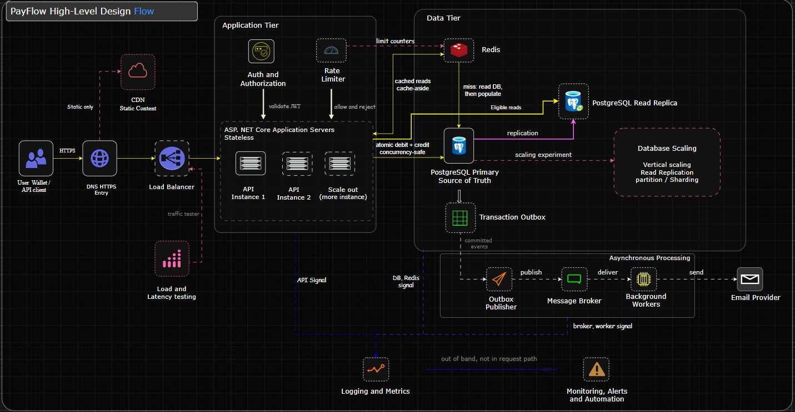
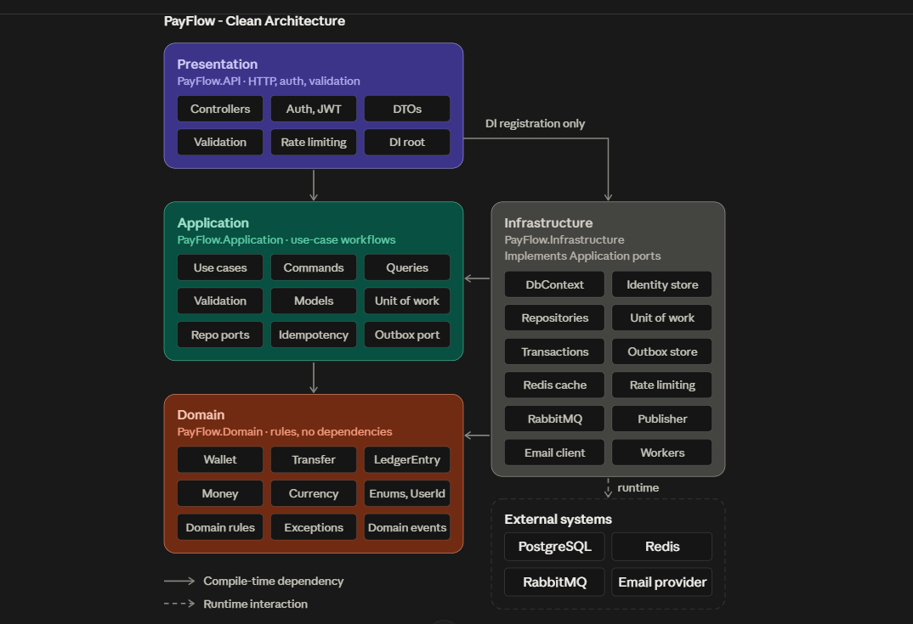
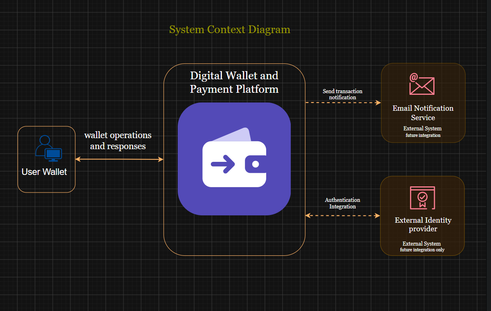
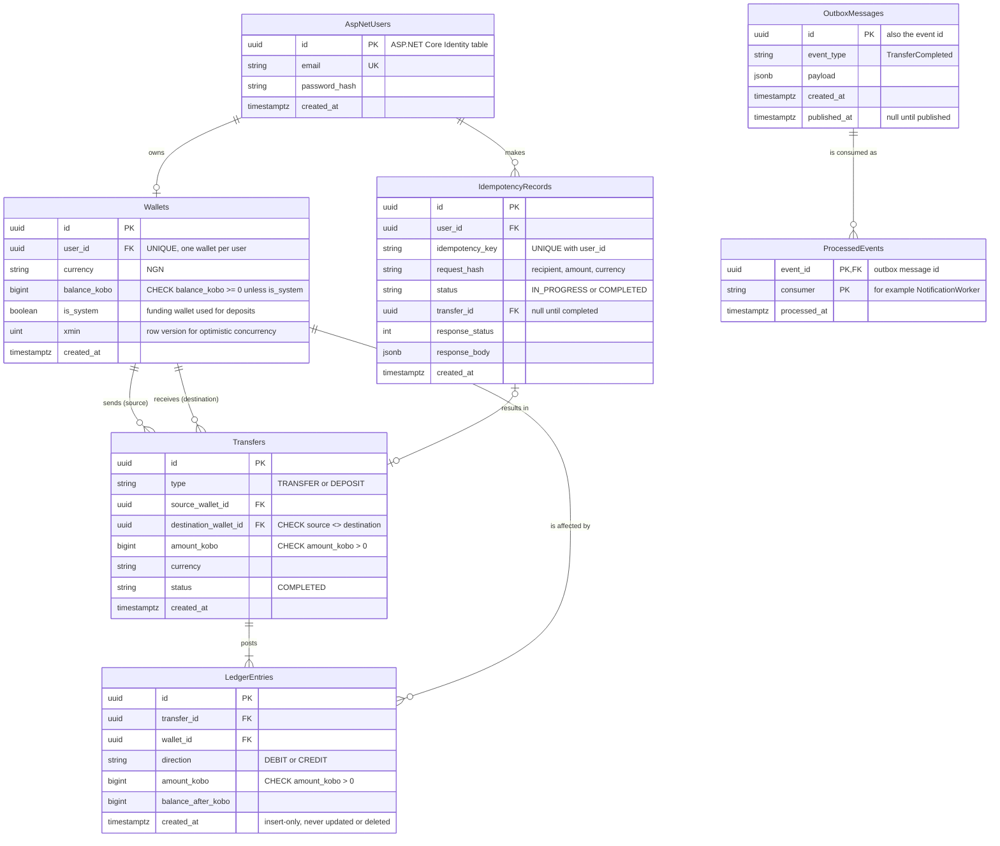

# PayFlow

**A System-Design-Driven Digital Wallet and Payment Platform Built with C# and ASP.NET Core**

PayFlow is a simulated digital wallet and payment platform designed to explore how reliable, secure, and scalable backend systems are designed and built.

The project supports user authentication, digital wallet management, simulated deposits, wallet-to-wallet transfers, and transaction history. It is a practical learning project that applies the concepts from *System Design Interview – An Insider's Guide (Volume 1)* by Alex Xu, together with database transaction and idempotency techniques from *Designing Data-Intensive Applications* by Martin Kleppmann.

PayFlow is being developed incrementally, with architectural decisions documented before implementation and validated through automated tests and measured performance experiments.

> **Project scope:** PayFlow uses simulated funds denominated in Nigerian naira (NGN). It does not process real money or integrate with banks or external payment providers.

## Project Goals

- Apply system design concepts from *System Design Interview, Vol. 1* to a working backend.
- Build a secure backend API using C# and ASP.NET Core Web API.
- Apply Clean Architecture to separate business logic from infrastructure.
- Maintain correct wallet balances during concurrent financial operations.
- Explore database transactions, idempotency, and reliable event processing.
- Estimate system capacity using back-of-the-envelope calculations.
- Design for horizontal scaling, caching, asynchronous processing, and fault recovery.
- Validate each architectural decision with automated tests and load-test measurements.
- Document the design process and trade-offs transparently.

## System Design Concepts Applied

Each concept is introduced only when it is built and tested. The status column reflects the real state.

| Vol. 1 chapter | Concept | How PayFlow applies it | Status |
|---|---|---|---|
| 1. Scale from zero to millions | Stateless servers, load balancer, caching, replication, message queue | Multiple API instances behind a load balancer, Redis cache, PostgreSQL read replica, RabbitMQ | Designed |
| 2. Back-of-the-envelope estimation | Traffic, storage and peak-load estimates | [Capacity estimation](docs/capacity-estimation.md), later compared with measured results | Done |
| 3. Interview framework | Requirements, estimates, high-level design, deep dive | Documentation follows this order | Done |
| 4. Rate limiter | Rate limiting algorithms | ASP.NET Core rate limiting with shared Redis counters | Planned |
| 5. Consistent hashing | Data partitioning | Optional sharding experiment | Optional |
| 6. Key-value store | Replication and consistency trade-offs | Replica lag demonstration, balance reads kept on the primary | Planned |
| 7. Unique ID generator | Distributed, sortable IDs | Transaction and event identifiers | Planned |
| 10. Notification system | Reliable asynchronous delivery | Transactional outbox, retries, dead-letter queue, duplicate-safe consumers | Planned |

Idempotency, double-entry ledgers and transaction isolation come mainly from *Designing Data-Intensive Applications*.

## Technology Stack

| Technology | Purpose |
|---|---|
| C# | Primary programming language |
| ASP.NET Core Web API | Backend HTTP API |
| Clean Architecture | Separation of business rules from infrastructure |
| ASP.NET Core Identity | User and credential management |
| JWT Bearer Authentication | API request authentication |
| PostgreSQL | Source of truth for wallet and transaction data |
| Entity Framework Core | Database access and object-relational mapping |
| Redis | Planned caching and distributed rate limiting |
| RabbitMQ | Planned asynchronous processing |
| .NET Worker Services | Planned outbox publisher and notification worker |
| Docker Compose | Planned local environment |
| Git and GitHub | Version control and project documentation |
| draw.io and Mermaid | Architecture and data-model diagrams |

Technologies marked as planned will be introduced in later development stages.

## Core Features

- User registration and authentication.
- One digital wallet per user in the initial version.
- Wallet balance inquiry.
- Restricted administrative operations for simulated deposits.
- Transfers between PayFlow wallets.
- Transaction history.
- Transaction validation, integrity protection, and idempotency.
- Automated tests, logging, and performance measurement.

## Design Highlights

- **PostgreSQL is the only authority for balances.** Redis is never used for a transfer decision.
- **Money is stored as integer kobo**, never floating point.
- **Overspending is prevented in two layers:** a conditional debit inside one database transaction, plus a `CHECK` constraint.
- **Idempotency is enforced by the database** with a unique constraint on `(user_id, idempotency_key)`.
- **Ledger entries are immutable.** Reversals add compensating entries.
- **Events are published after commit** through a transactional outbox.

## Architecture Overview

PayFlow follows Clean Architecture with four projects: `PayFlow.Domain`, `PayFlow.Application`, `PayFlow.Infrastructure` and `PayFlow.Api`. Dependencies point inward, and the Domain depends on nothing.

The system context shows PayFlow's boundary, with email notification and an external identity provider as future integrations.

The initial implementation focuses on authenticated API operations and PostgreSQL-backed wallet and transaction management. Load balancing, caching, replication and asynchronous processing are introduced and evaluated incrementally rather than assumed from the start.

## Data Model

PayFlow uses PostgreSQL as the authoritative source of truth, employing an immutable double-entry ledger, balance invariants, and a transactional outbox.

> For full table constraints, indexes, and transaction design notes, see [Data Model Documentation](docs/data-model.md).

## System Design Documentation

| Document | Status |
|---|---|
| [Requirements Specification](docs/requirements.md) | Completed |
| [Back-of-the-Envelope Estimation](docs/capacity-estimation.md) | Completed |
| [High-Level Design](docs/high-level-design.md) | Completed |
| [Data Model](docs/data-model.md) | Completed |
| Architecture Decision Records | Planned |
| Experiment Results | Planned |

All capacity figures are hypothetical assumptions, not measured results.

## Experiments

Each architectural component is evaluated with a small experiment, written up in `docs/experiments/` with a hypothesis, setup, measurements and conclusion.

| Experiment | Question | Status |
|---|---|---|
| E1. Horizontal scaling | How do throughput and p95 latency change from 1 to 2 or 3 API instances? | Planned |
| E2. Caching | What does Redis cache-aside change for read latency and database load? | Planned |
| E3. Read replica | How much replica lag appears under load, and which reads can safely use it? | Planned |
| E4. Rate limiting | How do different algorithms behave under bursts? | Planned |
| E5. Outbox reliability | Are events lost or duplicated if the publisher or worker crashes? | Planned |
| E6. Transfer correctness | Do parallel transfers and repeated idempotency keys ever overspend or double-execute? | Planned |
| E7. Sharding (optional) | What does partitioning cost and gain at this scale? | Optional |

## Getting Started

Setup instructions will be added when the initial ASP.NET Core solution, database configuration, and authentication implementation are ready. The goal is a single-command start with `docker compose up`.

## Testing and Performance

Automated tests will verify business rules, authentication, authorization, transfer correctness (including concurrency and idempotency), and failure handling.

Performance results will be reported after load testing. Capacity estimates are identified as assumptions, while measured results are reported separately.

## Project Status

**Current stage:** Design complete, implementation starting.

| Area | Status |
|---|---|
| Requirements, estimation, architecture, data model | Complete |
| Core API (auth, wallets, transfers, history) | In progress |
| Automated tests and CI | Planned |
| Redis, RabbitMQ and outbox | Planned |
| Load testing and experiments | Planned |

Features, diagrams, results and infrastructure are marked according to their actual implementation status.

## Author

**Ibraheem**
[GitHub](https://github.com/highfrezh) · [LinkedIn](https://linkedin.com/in/olabintan-ibraheem)

## Disclaimer

PayFlow is an educational and portfolio project using simulated funds. It is not a production banking platform and is not intended to handle real customer money.
