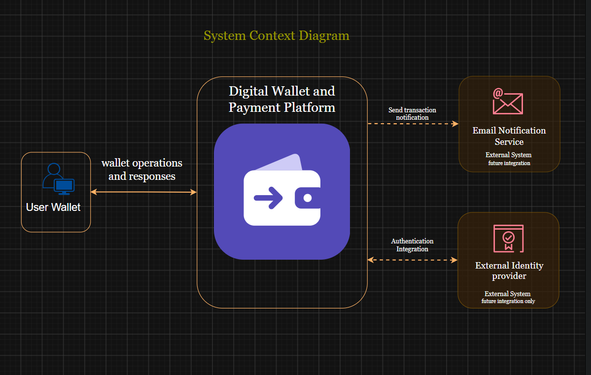

# PayFlow

**A System-Design-Driven Digital Wallet and Payment Platform Built with C# and ASP.NET Core**

PayFlow is a simulated digital wallet and payment platform designed to explore how reliable, secure, and scalable backend systems are designed and built.

The project supports user authentication, digital wallet management, simulated deposits, wallet-to-wallet transfers, and transaction history. It is also a practical learning project for applying system design principles, database transaction management, distributed systems, and software architecture.

PayFlow is being developed incrementally, with architectural decisions documented before implementation and validated through automated tests and performance experiments.

> **Project scope:** PayFlow uses simulated funds denominated in Nigerian naira (NGN). It does not initially process real money or integrate with banks or external payment providers.

## Project Goals

- Build a secure backend API using C# and ASP.NET Core Web API.
- Apply Clean Architecture to separate business logic from infrastructure.
- Maintain correct wallet balances during concurrent financial operations.
- Explore database transactions, idempotency, and reliable transaction processing.
- Estimate system capacity using back-of-the-envelope calculations.
- Design for horizontal scaling, caching, asynchronous processing, and fault recovery.
- Validate architectural decisions through automated testing and load testing.
- Document the system design process and trade-offs transparently.

## Technology Stack

| Technology | Purpose |
|---|---|
| C# | Primary programming language |
| ASP.NET Core Web API | Backend HTTP API |
| ASP.NET Core Identity | User and credential management |
| JWT Bearer Authentication | API request authentication |
| PostgreSQL | Persistent storage for wallet and transaction data |
| Entity Framework Core | Database access and object-relational mapping |
| Redis | Planned caching and distributed rate limiting |
| Message Broker | Planned asynchronous processing |
| Git and GitHub | Version control and project documentation |
| draw.io | System design and architecture diagrams |

Technologies marked as planned will be introduced in later development stages.

## Core Features

- User registration and authentication.
- One digital wallet per user in the initial version.
- Wallet balance inquiry.
- Restricted administrative operations for simulated deposits.
- Transfers between PayFlow wallets.
- Transaction history.
- Transaction validation, integrity protection, and idempotency.
- Automated tests, logging, and performance measurement.

## System Design Documentation

PayFlow's architecture will be documented progressively as the project evolves.

| Document | Status |
|---|---|
| [Requirements Specification](docs/requirements.md) | Completed |
| | Completed |
| [Back-of-the-Envelope Estimation](docs/capacity-estimation.md) | Completed |
| [High-Level Architecture](docs/diagrams/payflow-high-level-design.png) | Complete|
| Clean Architecture Diagram | Planned |
| Wallet Transfer Sequence Diagram | Planned |
| Data Model and Transaction Design | Planned |
| Architecture Decision Records | Planned |
| Testing and Performance Results | Planned |

## Architecture Overview

The initial implementation will focus on authenticated API operations and PostgreSQL-backed wallet and transaction management.

The target architecture will account for future horizontal scaling, load balancing, caching, asynchronous processing, database replication, and failure recovery. These components will be introduced and evaluated incrementally rather than assumed to be implemented from the beginning.

Architecture diagrams and detailed design documents will be linked here as they become available.

## Getting Started

Setup instructions will be added when the initial ASP.NET Core solution, database configuration, and authentication implementation are ready.

## Testing and Performance

Automated tests will verify business rules, authentication, authorization, transfer correctness, and failure handling.

Performance results will be reported after load testing. Capacity estimates will be identified as assumptions, while measured results will be reported separately.

## Project Status

**Current stage:** Requirements and system design.

PayFlow is being developed incrementally. Features, diagrams, performance results, and infrastructure components will be marked according to their actual implementation status.

## Disclaimer

PayFlow is an educational and portfolio project using simulated funds. It is not a production banking platform and is not intended to handle real customer money.
