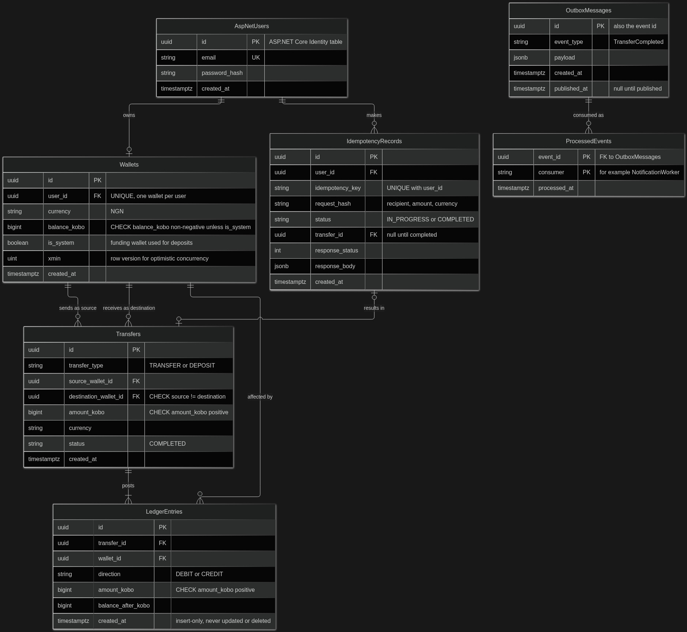

# PayFlow - Data Model

PostgreSQL is the source of truth for all financial data. This document describes the tables, their relationships and the constraints that protect financial correctness.

## Constraints and indexes

| Table | Constraint or index | Purpose |
|---|---|---|
| Wallets | `UNIQUE (user_id)` | One wallet per user |
| Wallets | `CHECK (balance_kobo >= 0 OR is_system)` | Last line of defense against overspending |
| Transfers | `CHECK (source_wallet_id <> destination_wallet_id)` | No self-transfers |
| Transfers | `CHECK (amount_kobo > 0)` | No zero or negative transfers |
| Transfers | Index `(source_wallet_id, created_at)` and `(destination_wallet_id, created_at)` | Transaction history |
| LedgerEntries | Index `(wallet_id, created_at DESC)` | Fast history and reconciliation per wallet |
| LedgerEntries | No `UPDATE` or `DELETE` permission for the app role | Ledger stays immutable |
| IdempotencyRecords | `UNIQUE (user_id, idempotency_key)` | Blocks a duplicate or concurrent execution |
| OutboxMessages | Partial index `ON (created_at) WHERE published_at IS NULL` | Cheap lookup of unpublished events |
| ProcessedEvents | `PRIMARY KEY (event_id, consumer)` | Consumers handle duplicate delivery safely |

## Design notes

- **Money is stored as integer kobo** (`bigint`), never `decimal` or `float`. NGN 2,000 is stored as `200000`. This avoids rounding errors, and the domain `Money` value object converts to and from naira.
- **Hybrid ledger.** Each transfer writes two immutable ledger entries (one debit, one credit), and also updates `Wallets.balance_kobo` in the same transaction. The ledger gives you an audit trail, and the balance column gives fast reads and a row to lock.
- **Reconciliation invariants** you can test:
  1. For every wallet, `balance_kobo` equals the sum of its credits minus the sum of its debits.
  2. For every transfer, its debit and credit amounts are equal.
- **Deposits** are transfers from a seeded system funding wallet (`is_system = true`), so double-entry holds for every movement of funds.
- **Reversals** insert a new transfer with compensating ledger entries. They never edit or delete history.
- **Idempotency record lifecycle.** The record is inserted as `IN_PROGRESS` inside the transfer transaction and updated to `COMPLETED` with the stored response before commit. A rollback removes it, so a failed attempt can be retried.
- **Identity tables.** `AspNetUsers` belongs to ASP.NET Core Identity in the Infrastructure layer. The Domain layer only holds a `UserId` value, and `Wallets.user_id` is a plain foreign key to that table.
- **Optimistic concurrency.** PostgreSQL's `xmin` system column can serve as the EF Core row version. Transfers still lock both wallet rows in a consistent order (lowest id first) to avoid deadlocks.
