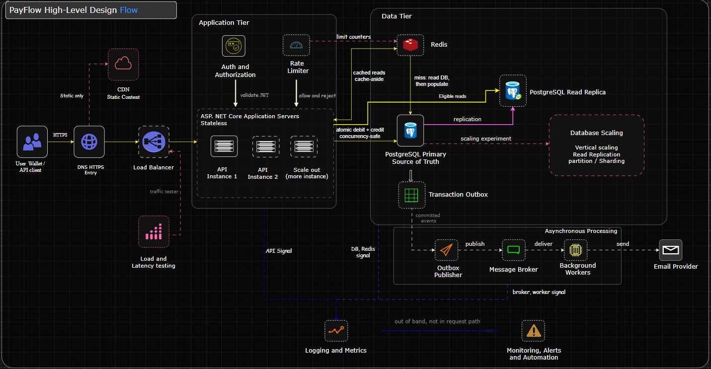

# PayFlow High-Level Design (HLD)

## 1. Overview

PayFlow is a simulated NGN digital wallet and internal payment platform built with C# and ASP.NET Core Web API.

The purpose of this project is to apply system design concepts to a practical application, including load balancing, caching, database replication, asynchronous processing, rate limiting, and observability.

This document describes PayFlow's target architecture, the responsibilities of its major components, and how requests and data flow through the system.

The architecture will be implemented incrementally. A component appearing in this design does not imply that it has already been implemented or tested.

## 2. Architectural Goals

PayFlow's architecture aims to:

- Provide secure user authentication and authorization.
- Support wallet creation, simulated deposits, balance inquiries, and internal transfers.
- Maintain financial data integrity and prevent duplicate transfers.
- Support horizontal scaling of stateless API instances.
- Reduce database load through appropriate caching and read scaling.
- Process non-critical background tasks asynchronously.
- Provide visibility into system performance through logging and metrics.
- Support performance experiments that demonstrate the impact of architectural decisions.

## 3. Technology Stack

| Component | Technology | Responsibility |
|---|---|---|
| Backend API | C# / ASP.NET Core Web API | Handles client requests and application operations |
| Application architecture | Clean Architecture | Separates business rules from infrastructure concerns |
| Authentication | ASP.NET Core Identity and JWT | Manages user accounts and authenticates API requests |
| Primary database | PostgreSQL | Stores authoritative financial and application records |
| Cache and rate-limit coordination | Redis | Caches suitable reads and coordinates distributed rate limits |
| Message broker | RabbitMQ | Delivers asynchronous messages to consumers |
| Background processing | .NET Worker Services | Processes notifications and other background tasks |
| Traffic distribution | Load balancer / reverse proxy | Distributes requests across healthy API instances |
| Observability | Logging, metrics, health checks, and alerts | Helps monitor performance and diagnose failures |
| Performance testing | Load-testing tools | Measures throughput, latency, and resource utilization |

The final choice of deployment and observability tools will be documented as implementation decisions are made.

## 4. High-Level Architecture Diagram

The diagram below presents PayFlow's target architecture, including the application tier, data tier, asynchronous processing, and observability.

## 5. Major Components

### 5.1. Client and Traffic Entry

**API clients**

Clients send HTTPS requests to PayFlow to authenticate, retrieve wallet information, initiate transfers, and view transaction history.

Clients must not connect directly to PostgreSQL, Redis, or the message broker.

**DNS and HTTPS**

DNS resolves the API domain to the appropriate network destination. HTTPS protects communication between clients and the API entry point.

**Load balancer**

The load balancer distributes incoming requests across healthy ASP.NET Core API instances. It supports horizontal scaling and prevents all application traffic from depending on one API instance.

**CDN**

A Content Delivery Network may serve eligible static assets if the project exposes suitable content. It is a separate deployment experiment, not a mandatory stage in the wallet API request path.

Authenticated financial responses, wallet balances, and transfer operations must not be publicly cached by the CDN.

### 5.2. Application Tier

PayFlow runs on ASP.NET Core Web API. The target architecture supports multiple API instances behind the load balancer.

The API instances are designed to be stateless. Authentication relies on validated bearer tokens rather than a login session stored only in one instance's memory.

The application follows Clean Architecture:

- **API / Presentation:** HTTP endpoints, middleware, and request handling.
- **Application:** Use cases, application services, and interfaces for required operations.
- **Domain:** Wallet entities, financial rules, and business invariants.
- **Infrastructure:** Database persistence and implementations of external service interfaces.

These are logical layers within the application, not independent microservices.

The dependency direction must preserve the independence of the Domain layer. Infrastructure implements interfaces defined by inner layers rather than defining the business rules.

### 5.3. Authentication and Authorization

PayFlow uses ASP.NET Core Identity for user management and JWT bearer authentication for API requests.

The application validates bearer tokens and applies authorization rules to protected operations.

Authentication determines who is making a request. Authorization determines whether that user is permitted to perform the requested operation.

For example, a user must not be able to initiate a transfer from another user's wallet simply by supplying a different wallet identifier.

### 5.4. Rate Limiting

The server-side rate limiter controls how frequently clients can make requests.

Redis provides shared counters or coordination when rate limits must apply across multiple API instances.

The application can reject requests that exceed configured limits. Rate limiting protects the API from excessive traffic but does not replace authentication, authorization, or financial validation.

### 5.5. PostgreSQL Primary

PostgreSQL Primary is the authoritative source of truth for wallet balances and financial transactions.

It stores application records such as:

- Users and identity-related persistence.
- Wallets and balances.
- Transfers and transaction records.
- Idempotency records.
- Audit records.
- Transactional outbox events.

Financial operations must use database transactions and appropriate concurrency controls to prevent partial transfers and overspending.

A successful transfer must be committed to PostgreSQL before the API reports it as successful.

### 5.6. PostgreSQL Read Replica

The read replica receives replicated data from PostgreSQL Primary.

It can serve suitable read-heavy queries, reducing the read workload on the primary database.

Replication may lag behind the primary. Therefore, requests that require the latest authoritative financial state must use the primary or an explicitly designed consistency mechanism.

The API connects directly to the primary for writes and critical reads, and to the replica for eligible reads. The replica is not a mandatory intermediary between the API and the primary.

### 5.7. Redis Cache

Redis stores selected data that can benefit from faster repeated reads.

For suitable queries, the application follows a cache-aside pattern:

1. Check Redis for the requested data.
2. If the data is present and sufficiently fresh, return it.
3. If the data is missing, retrieve it from PostgreSQL.
4. Populate the cache according to the configured caching policy.

Cache invalidation and freshness must be considered when underlying data changes.

Redis is not the source of truth for wallet balances. Transfer authorization, available-balance validation, and financial updates must rely on authoritative database state.

### 5.8. Database Scaling

PayFlow will use controlled experiments to understand database scaling strategies.

- **Vertical scaling:** Increase the resources available to a database server.
- **Read replication:** Distribute suitable read workloads across replicas.
- **Partitioning or sharding:** Explore dividing data across partitions or database nodes if workload requirements justify the added complexity.

These strategies solve different problems. Read replicas do not automatically increase write capacity, and sharding is not required for the initial implementation.

### 5.9. Asynchronous Processing

PayFlow uses a transactional outbox pattern to reliably connect committed database operations to asynchronous processing.

The flow is:

1. The financial transaction and its corresponding outbox event are written in the same PostgreSQL transaction.
2. An outbox publisher retrieves committed, unpublished events.
3. The publisher sends events to RabbitMQ.
4. Background workers consume the messages.
5. Workers perform tasks such as sending email notifications.
6. Failed messages are retried or handled through an appropriate dead-letter mechanism.

Consumers must handle duplicate message delivery safely.

A notification failure must not reverse a committed wallet transfer. The message broker is not a synchronous prerequisite for completing the financial database transaction.

### 5.10. Logging, Metrics, and Monitoring

Observability provides information about the health and performance of PayFlow.

The system will collect or expose:

- Structured application logs.
- API request rate, error rate, and latency.
- Database query performance and connection usage.
- Replication lag.
- Redis latency and cache hit rate.
- Queue depth, processing latency, and retry counts.
- API and worker health.

Monitoring and alerting help identify abnormal behavior and guide troubleshooting. They operate as supporting infrastructure rather than as a synchronous dependency of every request.

## 6. Main Request and Data Flows

### 6.1. General API Request

1. The client sends an HTTPS request.
2. DNS resolution directs the client to the API entry point.
3. The load balancer selects a healthy API instance.
4. The rate limiter checks the request against the applicable policy.
5. The API validates authentication and authorization where required.
6. The application executes the relevant use case.
7. The application reads or writes the appropriate data source.
8. The API returns the result to the client.

### 6.2. Wallet Transfer

A wallet transfer is a critical synchronous operation.

1. The authenticated client submits a transfer request with a unique idempotency key.
2. The API validates the request and verifies that the sender is authorized to use the source wallet.
3. The application validates the amount, recipient, and relevant business rules.
4. PostgreSQL executes the debit, credit, transfer-record, and associated outbox operations within the required transaction boundary.
5. Concurrency controls prevent overspending when transfers occur simultaneously.
6. If all required operations succeed, PostgreSQL commits the transaction. Otherwise, the transaction is rolled back.
7. The API returns the committed result or an appropriate failure response.
8. The outbox publisher later delivers the committed event for asynchronous processing.

The exact database locking strategy, isolation level, ledger model, and idempotency behavior will be specified in the detailed wallet transfer design.

### 6.3. Cached Read

1. The API receives a read request.
2. The application checks Redis.
3. If a suitable cached value exists, it returns the value.
4. Otherwise, the application reads from PostgreSQL, returns the result, and populates the cache according to policy.

Only data suitable for caching should use this path.

### 6.4. Database Replication

PostgreSQL Primary sends changes to the read replica through the configured replication mechanism.

The application routes eligible read queries to the replica. The design must account for replication lag and must not assume that the replica always contains the latest committed changes.

### 6.5. Asynchronous Notifications

1. A transfer and its outbox event are committed together.
2. The outbox publisher sends the event to RabbitMQ.
3. A background worker consumes the event.
4. The worker requests notification delivery through the email provider.
5. Retries and duplicate handling prevent transient failures from causing unsafe repeated processing.

## 7. Key Architecture Decisions

| Decision | Reason |
|---|---|
| ASP.NET Core Web API | Provides the backend framework for the C# implementation |
| Stateless API instances | Supports horizontal scaling and easier instance replacement |
| PostgreSQL as the source of truth | Provides transactional storage for authoritative financial records |
| Redis for suitable caching | Reduces repeated database reads without replacing financial data authority |
| Direct primary and replica connections | Separates authoritative operations from eligible read-scaled queries |
| Transactional outbox | Reduces the risk of losing events between database commits and message publication |
| Asynchronous notification processing | Separates non-critical background work from financial transaction completion |
| Distributed rate-limit coordination | Supports shared request limits across API instances |
| Observability | Supports performance measurement, diagnosis, and operational monitoring |
| Incremental implementation | Allows individual architecture decisions to be tested and evaluated |

## 8. Performance Testing

Performance testing will evaluate how PayFlow behaves under controlled workloads.

Planned measurements include:

- Throughput and requests handled per second.
- Error rate under increasing load.
- p50, p95, and p99 request latency.
- API CPU and memory utilization.
- Database resource usage and query latency.
- Redis latency and cache hit rate.
- Queue depth and background-processing delay.

Experiments may compare one API instance with multiple instances, caching enabled versus disabled, and primary-only reads versus suitable replica reads.

Testing results will be documented separately from estimated capacity figures. Performance claims will be based on measurements from a recorded test environment.

## 9. Scope and Implementation Status

This document describes the target architecture, not a claim that every component is operational.

The implementation will proceed in stages, beginning with the core application and financial data model. Supporting infrastructure will be introduced and tested as its dependencies and design requirements become clear.

CDN deployment, partitioning or sharding, and advanced scaling experiments are optional extensions whose value will be evaluated against actual project needs.

The main architecture will remain focused on demonstrating sound backend engineering and system design rather than adding infrastructure without a clear purpose.

## 10. Related Documentation

- [Project README](../README.md)
- [Requirements Specification](requirements.md)
- [System Context Diagram](diagrams/payflow-system-context.png)
- [High-Level Design Diagram](diagrams/payflow-high-level-design.png)
- Back-of-the-Envelope Estimation: `capacity-estimation.md`

The next design milestone is the detailed wallet transfer design, covering the data model, transfer sequence, atomicity, concurrency control, and idempotency.
